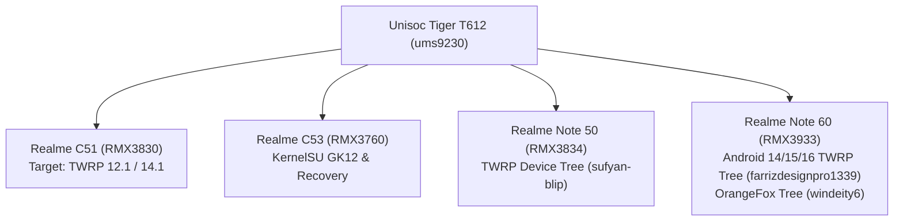

# Realme C51 (RMX3830) & Unisoc T612 TWRP/Recovery Guide

This reference document consolidates all research, build milestones, device tree architecture, and comparative findings across the **Realme Unisoc T612 (`ums9230`)** device family (Realme C51, C53, Note 50, Note 60).

---

## 1. Device Profile & Boot Architecture

| Specification | Details |
|---|---|
| **Device Model** | Realme C51 (`RMX3830`) / Realme C51s |
| **SoC** | Unisoc Tiger T612 (`ums9230` / `ums9230_latte` / `1h10`) |
| **CPU / GPU** | 2x Cortex-A75 @ 1.8GHz + 6x Cortex-A55 @ 1.8GHz, Mali-G57 MP1 |
| **Architecture** | ARM64 (`arm64-v8a`, 64-bit binder, 32/64 multi-arch) |
| **Partition Scheme** | Virtual A/B (VAB) with Dynamic Partitions (Super: ~4.5 GB) |
| **Recovery Partition** | **`vendor_boot`** (Header version 4, no dedicated `recovery.img`) |
| **Kernel / Ramdisk Split** | Stock kernel resides in `boot.img`; recovery second-stage ramdisk resides in `vendor_boot.img` |
| **Stock Vendor OS Base** | Shipped with Android 13 (`realme UI T Edition`), upgrading to Android 14/15 |
| **Maintainer Tag** | `MR.English2008` / `ME2008` |

---

## 2. GitHub Actions Build History & Status

| Run ID | Branch / Manifest | Target | Result | Root Cause / Notes |
|---|---|---|---|---|
| [`44160429712`](https://github.com/CodeVortax/android_device_realme_RMX3830_recovery/actions/runs/44160429712) | `twrp-12.1` | `vendorboot` | **SUCCESS** | Clean compilation. Successfully built `vendor_boot.img` (~100 MB). |
| [`44294058264`](https://github.com/CodeVortax/android_device_realme_RMX3830_recovery/actions/runs/44294058264) | `twrp-14.1` | `vendorboot` | **CANCELLED** | Stopped manually during testing. |
| [`44297782149`](https://github.com/CodeVortax/android_device_realme_RMX3830_recovery/actions/runs/44297782149) | `twrp-14.1` | `vendorboot` | **FAILED** | `Invalid lunch combo: twrp_ussi_arm64-eng`. AOSP 14 lunch overhaul & JDK mismatch. |

### Why Run 44297782149 Failed on `twrp-14.1`:
1. **Lunch Syntax Overhaul in Android 14 (AOSP 14)**:
   In AOSP 14 (`twrp-14.1`), Google redesigned the build configuration system. Valid lunch combos must include the release configuration flag:
   ```
   <product>-<release>-<variant> (e.g. twrp_ussi_arm64-trunk_staging-eng)
   ```
   Instead of the classic `<product>-<variant>` syntax accepted in Android 12.1 (`twrp_ussi_arm64-eng`).
2. **Java Version Requirement**:
   The workflow was configured with `java-version: '11'`. Android 14+ / `twrp-14.1` strictly requires **OpenJDK 17**.

---

## 3. Realme Unisoc Device Family with Android 14/15 Vendor Trees

Through codebase analysis and open-source investigation, here are the Realme Unisoc sister devices sharing the exact same hardware architecture:



### 1. Realme Note 60 (`RMX3933`) — *Most Critical Reference*
- **SoC**: Unisoc T612 (`ums9230_latte`) — Identical SoC, display controller, and storage controller to RMX3830.
- **Android Version**: Shipped with Android 14 / Android 15 (`realme UI T Edition`), targeting Android 16.
- **Reference Repos**:
  - [`farrizdesignpro1339/recovery_device_realme_RMX3933`](https://github.com/farrizdesignpro1339/recovery_device_realme_RMX3933) (TWRP device tree targeting Android 16 SDK 36)
  - [`windeity6/OrFox_RMX3933`](https://github.com/windeity6/OrFox_RMX3933) (OrangeFox recovery tree)
- **Key Breakthrough in RMX3933 Tree**:
  Unisoc bootloaders do not parse standard AOSP `vendor_boot` headers! AOSP `mkbootimg` writes DTB at `--dtb_offset` and bootconfig at the tail. Unisoc's SPL expects DTB size and load address at header offset `0x830`.
  The RMX3933 tree provides **`tools/repack_vendorboot.py`** which takes the compiled recovery ramdisk and repacks it into Unisoc's exact binary header structure.

### 2. Realme Note 50 (`RMX3834`)
- **SoC**: Unisoc T612 (`ums9230`)
- **Reference Repos**:
  - `sufyan-blip/twrp_device_tree_RMX3834`
  - `NTeditor/realme_rmx3834_common`, `NTeditor/RMX3834_recovery_repair`
- Shares the same display panel drivers and fastbootd configurations.

### 3. Realme C53 (`RMX3760`) & Narzo N53 (`RMX3761`)
- **SoC**: Unisoc T612 (`ums9230_latte`)
- Kernel & module architecture matches RMX3830 (both use `massatr` board platform tree).

---

## 4. Key Lessons & Fixes Already Identified

### A. The Unisoc Vendor Boot Repack (`tools/repack_vendorboot.py`)
Standard TWRP workflows create an AOSP-compliant `vendor_boot.img`. While this passes the build compiler, flashing it directly to device may cause a hang or bootloop because the Unisoc bootloader looks at:
- `0x834`: DTB size
- `0x838`: DTB load address (`0x01f00000`)
- `0x84c`: Bootconfig size (`androidboot.hardware=ums9230_latte`)

Adding the repack script ensures any built `vendor_boot.img` is 100% accepted by the device bootloader.

### B. MTP & ADB USB ConfigFS Gadget
The USB gadget triggers in `SamuraiArtem`'s RMX3830 recovery resolve the classic Unisoc issue where turning on MTP breaks ADB:
- Single composite gadget binding `ffs.adb` + `ffs.mtp` (`0x18D1 / 0x4EE2`).
- Mount path set to `/dev/usb-ffs/mtp` instead of `/dev/ffs-mtp`.

### C. Userspace Fastbootd
Unisoc bootloaders reject the standard `reboot,fastboot` command and reboot back into stock recovery. The userspace fastbootd patch (`twfunc-fastbootd-userspace.patch`) switches `sys.usb.config=fastboot` directly inside TWRP without restarting the device.

---

## 5. Decision Matrix for Moving Forward

1. **Option A: Perfect the Working TWRP 12.1 Build**
   - We already have a proven, successful compiling baseline (`44160429712`).
   - Add the `repack_vendorboot.py` tool from RMX3933 to the workflow so the resulting release image is flashed cleanly to the device.
   - Maintainer tag `MR.English2008` is already merged.
   - Flashes GSIs, Magisk, KernelSU, wipes partitions, fastbootd. (Data decryption on Android 15 requires DFE or formatting).

2. **Option B: Upgrade to TWRP 14.1 (Android 14/15 Support)**
   - Update `build-TWRP.yml`:
     - Switch Java to OpenJDK 17 (`java-version: '17'`).
     - Adjust lunch target from `twrp_ussi_arm64-eng` to `twrp_ussi_arm64-trunk_staging-eng` (or update `AndroidProducts.mk`).
   - Sync updated crypto and Keymint 2.0/3.0 policies to allow encrypted `/data` decryption on Android 14/15.
   - Include `repack_vendorboot.py` in the post-compile step.
